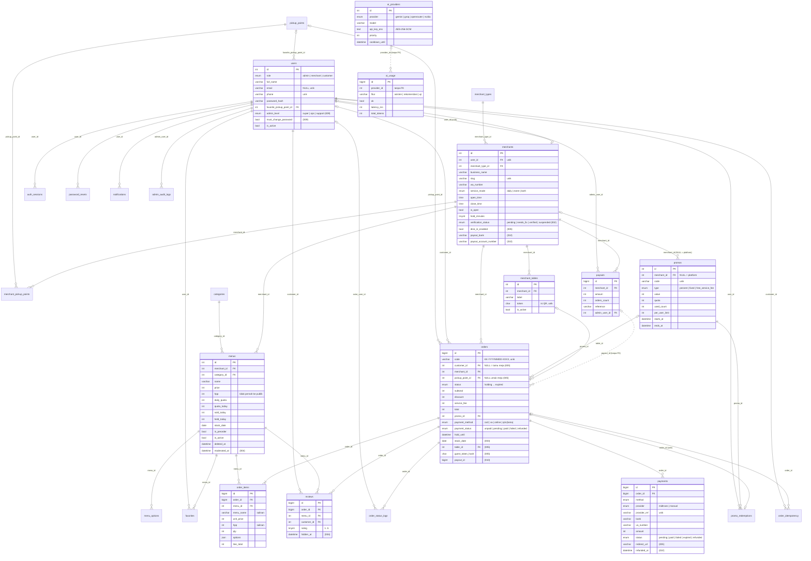

# ERD KateringKita

Dokumen ini disusun dari skema yang benar-benar dipakai backend: `backend/database/migrations/001_init.sql` sampai `010_pencairan.sql`, serta kode di `backend/src/services/`. Kolom yang ditambah oleh migrasi lanjutan diberi tanda `(002)`, `(005)`, dan seterusnya.

Konvensi skema:

- Basis data MySQL 8 / TiDB Cloud. TiDB tidak mendukung `FOR SHARE`, trigger, dan `ALTER ... AFTER` ke kolom baru dalam pernyataan yang sama.
- Uang disimpan sebagai `INT` Rupiah. Tidak ada desimal.
- Waktu disimpan `DATETIME` dalam UTC. "Hari ini" (stok, laporan, kode pesanan) dihitung aplikasi dalam zona `Asia/Jakarta`.
- Kolom `created_at` berarti `DATETIME NOT NULL DEFAULT CURRENT_TIMESTAMP`; `updated_at` berarti sama plus `ON UPDATE CURRENT_TIMESTAMP`.
- Migrasi dijalankan `src/scripts/migrate.ts` dan dicatat di tabel `schema_migrations (name VARCHAR(255) PK, applied_at DATETIME)`.

## 1. Diagram

Tabel tanpa relasi di diagram: `categories`, `pickup_points`, `merchant_types`, `app_settings`, `server_logs`, `notifications` (hanya ke `users`), `admin_audit_logs` (hanya ke `users`), `schema_migrations`.

## 2. Kamus tabel

Total 28 tabel aplikasi + `schema_migrations`. Jenis kolom ditulis sesuai SQL. `NN` = NOT NULL.

### 2.1 Data master

**merchant_types** — jenis usaha penjual.

| Kolom | Tipe | Keterangan |
|---|---|---|
| id | INT PK AI | |
| name | VARCHAR(100) NN UNIQUE | |
| is_active | BOOLEAN NN DEFAULT TRUE | (002) bisa dinonaktifkan admin |
| sort_order | INT NN DEFAULT 0 | (002) |

Seed: Katering Nasi Box & Harian, Kudapan Snack & Kue, Kedai Minuman & Es, Paket Custom & Prasmanan Acara, Danus Organisasi Mahasiswa.

**categories** — kategori menu.

| Kolom | Tipe | Keterangan |
|---|---|---|
| id | INT PK AI | |
| name | VARCHAR(60) NN UNIQUE | |
| slug | VARCHAR(60) NN UNIQUE | dipakai filter katalog `?category=` |
| icon | VARCHAR(40) NULL | |
| sort_order | INT NN DEFAULT 0 | |
| is_active | BOOLEAN NN DEFAULT TRUE | |

Seed: nasi-box, ayam, martabak, snack, minuman, paket-acara, danusan.

**pickup_points** — titik temu / titik ambil di kampus.

| Kolom | Tipe | Keterangan |
|---|---|---|
| id | INT PK AI | |
| name | VARCHAR(120) NN UNIQUE | |
| description | VARCHAR(255) NULL | |
| is_active | BOOLEAN NN DEFAULT TRUE | |

Seed: Gedung Vokasi UB (Lt. 2), Kantin Vokasi UB, Gazebo Fakultas Ilmu Komputer. Tidak ada koordinat.

**app_settings** — pengaturan platform (key-value).

| Kolom | Tipe | Keterangan |
|---|---|---|
| setting_key | VARCHAR(60) PK | |
| setting_value | VARCHAR(255) NN | |
| updated_at | DATETIME | |

Kunci yang dipakai kode: `service_fee` (Rupiah per pesanan, seed `0`), `timezone` (`Asia/Jakarta`), `cs_whatsapp` (diisi lewat `PUT /admin/settings/cs-contact`).

### 2.2 Akun

**users** — semua akun: admin, penjual, pembeli.

| Kolom | Tipe | Keterangan |
|---|---|---|
| id | INT PK AI | |
| role | ENUM('admin','merchant','customer') NN | |
| full_name | VARCHAR(150) NN | |
| email | VARCHAR(150) NULL UNIQUE | wajib untuk pembeli, opsional penjual |
| phone | VARCHAR(20) NN UNIQUE | format `08` + 8–11 digit |
| password_hash | VARCHAR(255) NN | bcrypt |
| avatar_url | VARCHAR(500) NULL | |
| favorite_pickup_point_id | INT NULL | FK → pickup_points, ON DELETE SET NULL |
| is_active | BOOLEAN NN DEFAULT TRUE | |
| admin_level | ENUM('super','ops','support') NULL | (009) hanya untuk role admin |
| must_change_password | BOOLEAN NN DEFAULT FALSE | (009) sandi sementara dari admin super |
| created_at, updated_at | DATETIME | |

**auth_sessions** — daftar sesi JWT; logout mengisi `revoked_at`.

| Kolom | Tipe | Keterangan |
|---|---|---|
| id | BIGINT PK AI | |
| user_id | INT NN | FK → users, ON DELETE CASCADE |
| jti | CHAR(36) NN UNIQUE | id token di dalam JWT |
| client | ENUM('web','mobile') NN | TTL token web 1 hari, mobile 30 hari |
| user_agent | VARCHAR(255) NULL | |
| expires_at | DATETIME NN | |
| revoked_at | DATETIME NULL | |
| created_at | DATETIME | |

Indeks: `idx_sessions_user (user_id)`.

**password_resets** — OTP lupa sandi (F11).

| Kolom | Tipe | Keterangan |
|---|---|---|
| id | BIGINT PK AI | |
| user_id | INT NN | FK → users, CASCADE |
| code_hash | VARCHAR(255) NN | OTP 6 digit di-hash |
| attempts | TINYINT NN DEFAULT 0 | maks 5 |
| expires_at | DATETIME NN | +10 menit |
| used_at | DATETIME NULL | sekali pakai |
| created_at | DATETIME | |

Indeks: `idx_resets_user (user_id, created_at)`.

### 2.3 Penjual

**merchants** — profil toko. Satu user penjual = satu toko.

| Kolom | Tipe | Keterangan |
|---|---|---|
| id | INT PK AI | |
| user_id | INT NN UNIQUE | FK → users, RESTRICT |
| merchant_type_id | INT NN | FK → merchant_types, RESTRICT |
| business_name | VARCHAR(150) NN | |
| slug | VARCHAR(160) NN UNIQUE | URL publik `/merchants/:slug` |
| description | VARCHAR(500) NULL | |
| address | VARCHAR(255) NN | |
| wa_number | VARCHAR(20) NN | tujuan pesan WhatsApp |
| logo_url | VARCHAR(500) NULL | |
| service_mode | ENUM('daily','event','both') NN DEFAULT 'both' | |
| open_time | TIME NN DEFAULT '07:00:00' | |
| close_time | TIME NN DEFAULT '16:00:00' | |
| is_open | BOOLEAN NN DEFAULT TRUE | "Status Dapur" |
| hold_minutes | TINYINT NN DEFAULT 5 | 1–30, lama penahanan porsi |
| daily_revenue_target | INT NN DEFAULT 0 | |
| qris_image_url | VARCHAR(500) NULL | **lama**: QRIS statis dihapus di F26, kolom dibiarkan |
| wa_template | TEXT NULL | NULL = templat bawaan |
| rating_avg | DECIMAL(3,2) NN DEFAULT 0 | dihitung ulang dari reviews |
| rating_count | INT NN DEFAULT 0 | |
| verified_at | DATETIME NULL | |
| verification_status | ENUM('pending','needs_fix','verified','suspended') NN DEFAULT 'pending' | (002) |
| verification_note | VARCHAR(500) NULL | (002) catatan admin saat `request-fix` |
| suspended_at | DATETIME NULL | (002) |
| suspended_reason | VARCHAR(500) NULL | (002) |
| dine_in_enabled | BOOLEAN NN DEFAULT FALSE | (005) terima pesanan dari meja |
| payout_bank | VARCHAR(20) NULL | (010) kode bank/e-wallet (`BANK_PENCAIRAN`) |
| payout_account_number | VARCHAR(30) NULL | (010) |
| payout_account_name | VARCHAR(100) NULL | (010) |
| payout_updated_at | DATETIME NULL | (010) |
| created_at, updated_at | DATETIME | |

Transisi `verification_status` (admin): `pending|needs_fix → verified` (verify), `pending → needs_fix` (request-fix, wajib alasan), `pending|needs_fix|verified → suspended` (suspend, wajib alasan), `suspended → verified` (reactivate). Hanya toko `verified` yang tampil di katalog dan bisa menerima pesanan.

**merchant_pickup_points** — titik temu yang dilayani toko (N:M).

| Kolom | Tipe | Keterangan |
|---|---|---|
| merchant_id | INT NN | PK bagian, FK → merchants CASCADE |
| pickup_point_id | INT NN | PK bagian, FK → pickup_points RESTRICT |

**merchant_tables** — meja fisik untuk pesan lewat QR (F21).

| Kolom | Tipe | Keterangan |
|---|---|---|
| id | INT PK AI | |
| merchant_id | INT NN | FK → merchants CASCADE |
| label | VARCHAR(30) NN | unik per toko: `uq_meja_label (merchant_id, label)` |
| token | CHAR(32) NN UNIQUE | isi QR; ganti token = QR lama mati |
| is_active | BOOLEAN NN DEFAULT TRUE | |
| created_at, updated_at | DATETIME | |

### 2.4 Menu

**menus** — menu per toko dengan stok harian.

| Kolom | Tipe | Keterangan |
|---|---|---|
| id | INT PK AI | |
| merchant_id | INT NN | FK → merchants RESTRICT |
| category_id | INT NN | FK → categories RESTRICT |
| name | VARCHAR(80) NN | |
| description | VARCHAR(500) NULL | |
| image_url | VARCHAR(500) NULL | Cloudflare R2 |
| unit_label | VARCHAR(30) NN DEFAULT 'porsi' | "porsi", "box", "isi 5" |
| price | INT NN | ≥ 1000 dan > hpp |
| hpp | INT NN | harga pokok; tidak pernah dikirim ke katalog publik |
| daily_quota | INT NN DEFAULT 0 | kuota bawaan tiap hari baru |
| quota_today | INT NN DEFAULT 0 | kuota hari ini, bisa diubah penjual (delta/absolut) |
| sold_today | INT NN DEFAULT 0 | |
| held_today | INT NN DEFAULT 0 | porsi tertahan pesanan `holding` |
| stock_date | DATE NULL | tanggal WIB untuk 3 kolom di atas; direset saat tanggal berganti |
| prep_minutes | SMALLINT NN DEFAULT 15 | |
| is_preorder | BOOLEAN NN DEFAULT FALSE | menu pre-order tidak dijual di meja |
| preorder_days | TINYINT NN DEFAULT 0 | H-n |
| min_order_qty | INT NN DEFAULT 1 | |
| sold_total | INT NN DEFAULT 0 | |
| rating_avg | DECIMAL(3,2) NN DEFAULT 0 | |
| rating_count | INT NN DEFAULT 0 | |
| is_active | BOOLEAN NN DEFAULT TRUE | |
| deleted_at | DATETIME NULL | soft delete |
| moderated_at | DATETIME NULL | (004) diturunkan admin; penjual tidak bisa mengaktifkan |
| moderation_reason | VARCHAR(255) NULL | (004) |
| created_at, updated_at | DATETIME | |

CHECK: `price >= 1000 AND hpp >= 0 AND price > hpp`; `quota_today >= sold_today + held_today`.
Indeks: `idx_menus_merchant (merchant_id, is_active)`, `idx_menus_category (category_id, is_active)`.

**menu_options** — pilihan tambahan per menu.

| Kolom | Tipe | Keterangan |
|---|---|---|
| id | INT PK AI | |
| menu_id | INT NN | FK → menus CASCADE |
| name | VARCHAR(60) NN | unik per menu (dicek di DTO, bukan DB) |
| extra_price | INT NN DEFAULT 0 | 0–1.000.000 |
| is_active | BOOLEAN NN DEFAULT TRUE | |

**favorites** — menu favorit pembeli.

| Kolom | Tipe | Keterangan |
|---|---|---|
| user_id | INT NN | PK bagian, FK → users CASCADE |
| menu_id | INT NN | PK bagian, FK → menus CASCADE |
| created_at | DATETIME | |

### 2.5 Promo

**promos** — promo platform (`merchant_id` NULL) atau promo toko.

| Kolom | Tipe | Keterangan |
|---|---|---|
| id | INT PK AI | |
| merchant_id | INT NULL | FK → merchants CASCADE; NULL = promo platform |
| code | VARCHAR(30) NN UNIQUE | kode promo di checkout |
| description | VARCHAR(255) NULL | |
| type | ENUM('percent','fixed','free_service_fee') NN | |
| value | INT NN DEFAULT 0 | persen atau Rupiah |
| max_discount | INT NULL | |
| min_subtotal | INT NN DEFAULT 0 | |
| quota | INT NULL | NULL = tanpa batas |
| used_count | INT NN DEFAULT 0 | diklaim atomik; turun saat pesanan batal/kedaluwarsa |
| per_user_limit | INT NN DEFAULT 1 | |
| starts_at, ends_at | DATETIME NN | |
| is_active | BOOLEAN NN DEFAULT TRUE | |
| created_at | DATETIME | |

**promo_redemptions** — pemakaian promo per pesanan.

| Kolom | Tipe | Keterangan |
|---|---|---|
| id | BIGINT PK AI | |
| promo_id | INT NN | FK → promos CASCADE |
| order_id | BIGINT NN UNIQUE | FK → orders CASCADE; satu promo per pesanan |
| user_id | INT NN | FK → users CASCADE |
| amount | INT NN | diskon yang diberikan |
| created_at | DATETIME | |

Indeks: `idx_redemptions_user (promo_id, user_id)`. Baris dihapus saat pesanan batal/kedaluwarsa.

### 2.6 Pesanan dan pembayaran

**orders** — pesanan pembeli (akun) atau tamu meja.

| Kolom | Tipe | Keterangan |
|---|---|---|
| id | BIGINT PK AI | |
| code | VARCHAR(20) NN UNIQUE | `KK-YYYYMMDD-XXXX`, dibuat server |
| customer_id | INT NULL | FK → users RESTRICT; NULL = tamu meja (005) |
| merchant_id | INT NN | FK → merchants RESTRICT |
| pickup_point_id | INT NULL | FK → pickup_points RESTRICT; NULL untuk pesanan meja (005) |
| status | ENUM('holding','confirmed','cooking','ready','completed','cancelled','expired') NN DEFAULT 'holding' | |
| customer_name | VARCHAR(150) NN | salinan saat checkout |
| customer_phone | VARCHAR(20) NULL | (005) |
| note | VARCHAR(255) NULL | |
| subtotal | INT NN | |
| discount | INT NN DEFAULT 0 | |
| service_fee | INT NN DEFAULT 0 | dari `app_settings.service_fee` |
| total | INT NN | dihitung server; nilai dari klien diabaikan |
| promo_id | INT NULL | FK → promos SET NULL |
| payment_method | ENUM('qris','va','cod','online') NN | (005) `qris` hanya data lama, ditolak 400 saat checkout |
| payment_status | ENUM('unpaid','pending','paid','failed','refunded') NN DEFAULT 'unpaid' | |
| hold_until | DATETIME NN | `created_at` + `hold_minutes` toko |
| stock_date | DATE NULL | (003) tanggal WIB stok yang ditahan |
| pickup_at | DATETIME NULL | pre-order |
| confirmed_at, cooking_at, ready_at, completed_at, cancelled_at | DATETIME NULL | |
| cancelled_by | ENUM('customer','merchant','system') NULL | |
| cancel_reason | VARCHAR(255) NULL | |
| table_id | INT NULL | (005) FK → merchant_tables SET NULL |
| guest_token_hash | CHAR(64) NULL | (005) SHA-256 token tamu; token asli hanya di peramban tamu |
| payout_id | BIGINT NULL | (010) terisi saat bagian penjual sudah dicairkan; **tanpa FK** ke payouts |
| created_at, updated_at | DATETIME | |

Indeks: `idx_orders_merchant (merchant_id, status, created_at)`, `idx_orders_customer (customer_id, created_at)`, `idx_orders_hold (status, hold_until)`.

Mesin status (`services/pesanan-status.service.ts`):

| Aksi | Oleh | Dari | Ke | Efek stok |
|---|---|---|---|---|
| confirm | penjual | holding | confirmed | held → sold |
| pay | sistem (notifikasi Midtrans) | holding | confirmed | held → sold; `payment_status = paid` |
| cook | penjual | confirmed | cooking | — |
| ready | penjual | cooking | ready | — |
| complete | penjual, pembeli | ready | completed | tunai: `payment_status = paid` |
| reject | penjual | holding, confirmed | cancelled | holding: porsi kembali; confirmed: batal |
| cancel | pembeli | holding, confirmed (hanya tunai) | cancelled | sama dengan reject |
| expire | sistem (job tiap 30 detik) | holding lewat `hold_until` | expired | porsi kembali |

Penjual tidak bisa `confirm` pesanan VA/online yang belum `paid`. Pesanan `holding` yang sudah lewat waktu hanya bisa di-`expire`.

**order_items** — baris pesanan, dengan salinan nama/harga/HPP.

| Kolom | Tipe | Keterangan |
|---|---|---|
| id | BIGINT PK AI | |
| order_id | BIGINT NN | FK → orders CASCADE |
| menu_id | INT NN | FK → menus RESTRICT |
| menu_name | VARCHAR(80) NN | salinan |
| unit_price | INT NN | harga + opsi, salinan |
| hpp | INT NN | salinan untuk laporan laba |
| qty | INT NN | CHECK `qty > 0` |
| options | JSON NULL | `[{"id":3,"name":"Sambal Pisah","extra_price":0}]` |
| line_total | INT NN | |

**order_status_logs** — riwayat perubahan status.

| Kolom | Tipe | Keterangan |
|---|---|---|
| id | BIGINT PK AI | |
| order_id | BIGINT NN | FK → orders CASCADE |
| from_status | VARCHAR(20) NULL | |
| to_status | VARCHAR(20) NN | |
| actor_user_id | INT NULL | FK → users SET NULL; NULL = sistem |
| created_at | DATETIME | |

Indeks: `idx_logs_order (order_id)`.

**order_idempotency** — klaim header `Idempotency-Key` per pembeli (003).

| Kolom | Tipe | Keterangan |
|---|---|---|
| customer_id | INT NN | PK bagian, FK → users CASCADE |
| idem_key | CHAR(36) NN | PK bagian, UUID huruf kecil |
| request_hash | CHAR(64) NN | sha256 body tervalidasi |
| order_id | BIGINT NULL | FK → orders CASCADE |
| created_at | DATETIME | |

**payments** — transaksi Midtrans per pesanan (VA atau Snap).

| Kolom | Tipe | Keterangan |
|---|---|---|
| id | BIGINT PK AI | |
| order_id | BIGINT NN | FK → orders CASCADE |
| method | ENUM('qris','va','cod','online') NN | (005) |
| provider | ENUM('midtrans','manual') NN | `manual` hanya data lama |
| provider_ref | VARCHAR(100) NULL UNIQUE | transaction_id Midtrans |
| bank | VARCHAR(20) NULL | VA: bca, bni, bri |
| va_number | VARCHAR(40) NULL | |
| qr_string | TEXT NULL | |
| amount | INT NN | |
| status | ENUM('pending','paid','failed','expired','refunded') NN DEFAULT 'pending' | |
| expires_at | DATETIME NULL | tidak melewati `orders.hold_until` |
| paid_at | DATETIME NULL | |
| raw_payload | JSON NULL | notifikasi terakhir dari Midtrans |
| redirect_url | VARCHAR(255) NULL | (005) halaman Snap |
| refunded_at | DATETIME NULL | (010) ditandai admin |
| refund_ref | VARCHAR(100) NULL | (010) nomor referensi pengembalian |
| created_at, updated_at | DATETIME | |

Indeks: `idx_payments_order (order_id)`.

**payouts** — pencairan dana non-tunai ke penjual (010).

| Kolom | Tipe | Keterangan |
|---|---|---|
| id | BIGINT PK AI | |
| merchant_id | INT NN | FK → merchants (tanpa klausa ON DELETE → RESTRICT) |
| amount | INT NN | Σ (`subtotal` − diskon promo toko) pesanan selesai sampai `until` |
| orders_count | INT NN | |
| bank, account_number, account_name | VARCHAR(20/30/100) NN | salinan rekening saat dicairkan |
| reference | VARCHAR(100) NN | nomor referensi transfer bank admin |
| note | VARCHAR(255) NULL | |
| admin_user_id | INT NULL | FK → users SET NULL |
| created_at | DATETIME | |

Indeks: `idx_payouts_waktu (created_at)`.

### 2.7 Ulasan dan notifikasi

**reviews** — satu ulasan per menu per pesanan selesai (F13).

| Kolom | Tipe | Keterangan |
|---|---|---|
| id | BIGINT PK AI | |
| order_id | BIGINT NN | FK → orders CASCADE |
| menu_id | INT NN | FK → menus CASCADE |
| customer_id | INT NN | FK → users CASCADE |
| rating | TINYINT NN | CHECK 1–5 |
| comment | VARCHAR(500) NULL | |
| hidden_at | DATETIME NULL | (004) disembunyikan admin: tidak tampil, tidak dihitung |
| hidden_reason | VARCHAR(255) NULL | (004) |
| created_at | DATETIME | |

Unik: `uq_review (order_id, menu_id)`.

**notifications** — notifikasi in-app.

| Kolom | Tipe | Keterangan |
|---|---|---|
| id | BIGINT PK AI | |
| user_id | INT NN | FK → users CASCADE |
| type | VARCHAR(40) NN | nilai yang dipakai kode: `order_status`, `promo`, `info` |
| title | VARCHAR(120) NN | |
| body | VARCHAR(255) NN | |
| data | JSON NULL | `{"order_code":...}`, `{"promo_code","merchant_id"}`, `{"audience"}` |
| read_at | DATETIME NULL | |
| created_at | DATETIME | |

Indeks: `idx_notif_user (user_id, read_at, created_at)`.

### 2.8 Admin dan operasional

**admin_audit_logs** — jejak aksi admin (002).

| Kolom | Tipe | Keterangan |
|---|---|---|
| id | BIGINT PK AI | |
| admin_user_id | INT NN | FK → users RESTRICT |
| action | VARCHAR(60) NN | mis. `merchant.verify`, `merchant.request_fix`, `merchant.suspend`, `merchant.reactivate`, `merchant.close_today`, `notification.broadcast` |
| target_type | VARCHAR(30) NN | |
| target_id | VARCHAR(40) NN | |
| reason | VARCHAR(500) NULL | |
| before_json, after_json | JSON NULL | |
| created_at | DATETIME | |

Indeks: `idx_audit_target (target_type, target_id)`, `idx_audit_created (created_at)`.

**ai_providers** — penyedia AI yang diatur admin (006).

| Kolom | Tipe | Keterangan |
|---|---|---|
| id | INT PK AI | |
| provider | ENUM('gemini','groq','openrouter','nvidia') NN | alamat API dikunci di kode |
| label | VARCHAR(60) NN | |
| model | VARCHAR(120) NN | |
| api_key_enc | TEXT NN | AES-256-GCM, kunci turunan `JWT_SECRET` |
| key_hint | VARCHAR(4) NN | 4 karakter terakhir |
| priority | INT NN DEFAULT 100 | kecil = dicoba dulu |
| is_active | BOOLEAN NN DEFAULT TRUE | |
| last_ok_at, last_error_at, cooldown_until | DATETIME NULL | |
| last_error | VARCHAR(255) NULL | |
| created_at, updated_at | DATETIME | |

Indeks: `idx_ai_urut (is_active, priority)`.

**ai_usage** — satu baris per percobaan ke penyedia AI (008). Disimpan 90 hari.

| Kolom | Tipe | Keterangan |
|---|---|---|
| id | BIGINT PK AI | |
| provider_id | INT NULL | **tanpa FK** (riwayat tetap ada bila penyedia dihapus); NULL = `GEMINI_API_KEY` env |
| provider | ENUM('gemini','groq','openrouter','nvidia') NN | |
| label, model | VARCHAR(60/120) NN | salinan |
| fitur | VARCHAR(20) NN | `asisten`, `rekomendasi`, `uji` |
| ok | BOOLEAN NN | |
| latency_ms | INT NN | |
| prompt_tokens, completion_tokens, total_tokens | INT NULL | |
| error | VARCHAR(255) NULL | |
| user_id | INT NULL | tanpa FK |
| created_at | DATETIME | |

Indeks: `idx_aiu_waktu (created_at)`.

**server_logs** — error 5xx dan request lambat > 2 detik (007). Disimpan 30 hari. Tidak menyimpan body, header, atau token.

| Kolom | Tipe | Keterangan |
|---|---|---|
| id | BIGINT PK AI | |
| request_id | VARCHAR(128) NULL | sama dengan header `X-Request-Id` |
| level | ENUM('error','slow') NN | |
| method | VARCHAR(10) NN | |
| path | VARCHAR(255) NN | tanpa query string |
| status | SMALLINT NN | |
| duration_ms | INT NN | |
| message | VARCHAR(500) NULL | |
| user_id | INT NULL | tanpa FK |
| created_at | DATETIME | |

Indeks: `idx_log_waktu (created_at)`, `idx_log_req (request_id)`.

## 3. Ringkasan relasi

| Induk | Anak | Kardinalitas | ON DELETE |
|---|---|---|---|
| users | merchants | 1 : 0..1 | RESTRICT |
| users | auth_sessions, password_resets, favorites, notifications, promo_redemptions, reviews, order_idempotency | 1 : N | CASCADE |
| users | orders (customer_id) | 0..1 : N | RESTRICT |
| users | order_status_logs (actor), payouts (admin) | 0..1 : N | SET NULL |
| users | admin_audit_logs | 1 : N | RESTRICT |
| pickup_points | users (favorit) | 0..1 : N | SET NULL |
| pickup_points | merchant_pickup_points, orders | 1 : N | RESTRICT |
| merchant_types | merchants | 1 : N | RESTRICT |
| merchants | menus, orders | 1 : N | RESTRICT |
| merchants | merchant_pickup_points, promos, merchant_tables | 1 : N | CASCADE |
| merchants | payouts | 1 : N | RESTRICT (bawaan) |
| categories | menus | 1 : N | RESTRICT |
| menus | menu_options, favorites, reviews | 1 : N | CASCADE |
| menus | order_items | 1 : N | RESTRICT |
| promos | orders | 0..1 : N | SET NULL |
| promos | promo_redemptions | 1 : N | CASCADE |
| merchant_tables | orders | 0..1 : N | SET NULL |
| orders | order_items, order_status_logs, payments, reviews, order_idempotency | 1 : N | CASCADE |
| orders | promo_redemptions | 1 : 0..1 | CASCADE |
| payouts | orders (payout_id) | 0..1 : N | tidak ada FK |
| ai_providers | ai_usage (provider_id) | 0..1 : N | tidak ada FK (disengaja) |

## 4. Temuan dari analisis skema

1. `orders.payout_id` tidak punya FK ke `payouts`. Penghapusan baris `payouts` tidak dicegah DB. Kode memang tidak pernah menghapus payout, tetapi integritasnya bergantung pada aplikasi.
2. `menus` memakai soft delete (`deleted_at`), tetapi FK `reviews.menu_id` dan `favorites.menu_id` adalah CASCADE. Hard delete menu akan menghapus ulasan dan favorit; `order_items.menu_id` RESTRICT mencegah hard delete menu yang pernah dipesan.
3. `payouts.merchant_id` tidak menulis klausa `ON DELETE`, jadi RESTRICT bawaan. Konsisten dengan `orders.merchant_id`.
4. `merchants.qris_image_url`, nilai enum `qris` di `orders.payment_method`/`payments.method`, dan `payments.provider = 'manual'` adalah sisa F10 lama. Sejak F26 tidak dipakai; checkout `qris` ditolak 400.
5. `orders.customer_id`, `pickup_point_id`, dan `customer_phone` dibuat NULL-able di 005 untuk tamu meja. Semua kueri pembeli harus menyaring `customer_id IS NOT NULL`; pesanan meja memakai `guest_token_hash` sebagai pengganti kepemilikan.
6. `admin_level` ada di `users`, bukan tabel terpisah; nilainya NULL untuk penjual dan pembeli. Hak akses ditentukan `middleware/admin-akses.ts` (super: semua; ops: tanpa admins/ai/finance/payouts/refunds/server dan tanpa tulis settings; support: hanya GET).
7. `server_logs`, `ai_usage` sengaja tanpa FK supaya log tidak hilang saat pengguna/penyedia dihapus dan agar penulisan log tidak gagal karena constraint.
8. `notifications.type` adalah VARCHAR bebas, bukan ENUM. Nilai nyata: `order_status`, `promo`, `info`. Komentar di 001 menyebut `system`, tetapi kode memakai `info` untuk pengumuman admin.
9. `app_settings.cs_whatsapp` tidak ada di seed; dibuat saat admin pertama kali mengisi kontak CS.
10. Skema lama `database/migrations/legacy/schema-lama.sql` (tabel `roles`, dll.) sudah tidak dipakai; `test/legacy-removed.test.ts` memastikan tabel lama tidak ada.

## 5. Penyimpanan lokal aplikasi mobile (terpisah dari backend)

`mobile/lib/data/app_database.dart` (Drift/SQLite, `schemaVersion = 2`) belum terhubung ke API. Tabelnya tidak memetakan skema backend:

| Tabel | Kolom |
|---|---|
| Orders | id INT PK AI, orderCode TEXT, productName TEXT, quantity INT, totalPrice REAL, status TEXT DEFAULT 'active', synced BOOL DEFAULT false, updatedAt INT (UTC millis) |
| Users | id INT PK AI, fullName TEXT, email TEXT UNIQUE, phone TEXT, createdAt INT |

Kata sandi dan token sesi disimpan di `flutter_secure_storage`; favorit (`liked_store.dart`) dan riwayat chat AI di `shared_preferences`. Produk, vendor, dan pesanan contoh di `models/*.dart` adalah data statis (`mockProducts`, `mockOrders`). Saat integrasi, tabel lokal ini perlu diganti atau dipetakan ke bentuk respons API (`GET /menus`, `GET /me/orders`).
